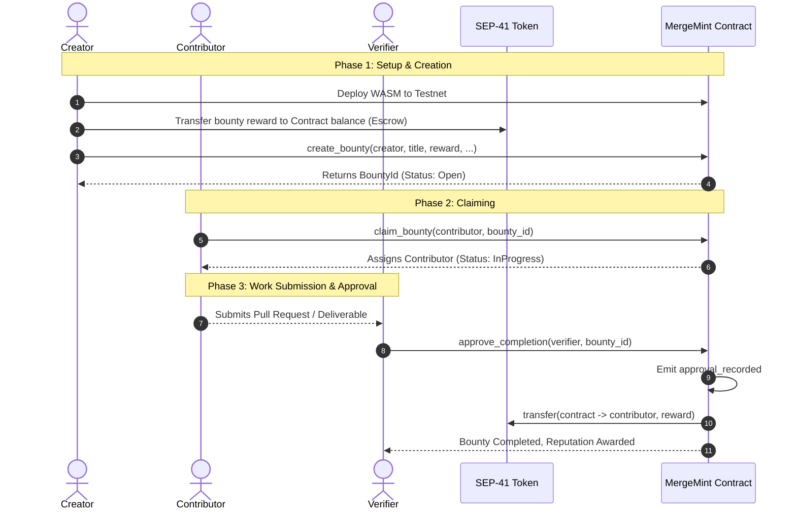

# Tutorial: Create and Pay Out Your First Bounty

This walkthrough guides you end-to-end through creating, claiming, and paying out a bounty on the Soroban Testnet using both the **Stellar CLI** and the **MergeMint Web UI**.

By the end of this tutorial, you will have:
1. Deployed the MergeMint contract to the Stellar Testnet.
2. Initialized a SEP-41 test reward token and funded the contract escrow.
3. Created a bounty with tags and metadata as the **Creator**.
4. Claimed the bounty with a separate **Contributor** account.
5. Approved completion and released the escrow payout as the **Verifier**.
6. Executed the same workflow through the web application interface.

---

## Architecture & Lifecycle Overview



---

## Prerequisites

Ensure you have the required tools installed on your development machine, pinned to repository standards:

1. **Rust (stable) & WASM Compilation Target:**
   ```bash
   curl --proto '=https' --tlsv1.2 -sSf https://sh.rustup.rs | sh
   # Target pinned in rust-toolchain.toml:
   rustup target add wasm32v1-none
   # Fallback/standard target:
   rustup target add wasm32-unknown-unknown
   ```

2. **Stellar CLI (Pinned version 23.0.1 per CONTRIBUTING.md):**
   ```bash
   cargo install --locked stellar-cli --version 23.0.1 --features opt
   stellar --version
   ```

3. **Node.js 20+ & pnpm** (if running the local Web UI):
   ```bash
   node --version
   ```

4. **Stellar Network Configuration:**
   Configure the testnet alias in the Stellar CLI:
   ```bash
   stellar network add \
     --global testnet \
     --rpc-url https://soroban-testnet.stellar.org:443 \
     --network-passphrase "Test SDF Network ; September 2015"
   ```

---

## Part 1: End-to-End Walkthrough via Stellar CLI

### Step 1: Generate Testnet Accounts

A complete bounty cycle involves three roles: **Creator**, **Contributor**, and **Verifier**. We generate dedicated keypairs and fund them using Friendbot:

```bash
# 1. Generate keys
stellar keys generate creator --network testnet
stellar keys generate contributor --network testnet
stellar keys generate verifier --network testnet

# 2. Fund accounts with testnet XLM using Friendbot
stellar keys fund creator --network testnet
stellar keys fund contributor --network testnet
stellar keys fund verifier --network testnet

# 3. Export public addresses for copy-paste convenience
export CREATOR_ADDR=$(stellar keys address creator)
export CONTRIBUTOR_ADDR=$(stellar keys address contributor)
export VERIFIER_ADDR=$(stellar keys address verifier)

echo "Creator:     $CREATOR_ADDR"
echo "Contributor: $CONTRIBUTOR_ADDR"
echo "Verifier:    $VERIFIER_ADDR"
```

---

### Step 2: Build and Deploy the Contract

Build the contract WASM binary and deploy it to Soroban Testnet:

```bash
# Compile optimized WASM (using toolchain target wasm32v1-none or wasm32-unknown-unknown)
cargo build --release --target wasm32v1-none

# Deploy contract to Testnet
export CONTRACT_ID=$(stellar contract deploy \
  --wasm target/wasm32v1-none/release/mergemint_contracts.wasm \
  --source-account creator \
  --network testnet)

echo "MergeMint Contract ID: $CONTRACT_ID"
```

---

### Step 3: Deploy Test Token & Fund Escrow

MergeMint payouts operate via standard SEP-41 token transfers from the contract balance. For testing, we deploy a standalone Stellar Asset Contract (SAC) or test token and fund the contract balance:

```bash
# Deploy a test token (e.g. wrapped native test asset or custom SAC)
export TOKEN_ID=$(stellar contract asset deploy \
  --asset native \
  --source-account creator \
  --network testnet)

echo "Reward Token ID: $TOKEN_ID"

# Transfer 10,000,000 stroops (1 XLM) from Creator to the Contract escrow balance
stellar contract invoke \
  --id $TOKEN_ID \
  --source-account creator \
  --network testnet \
  -- transfer \
  --from $CREATOR_ADDR \
  --to $CONTRACT_ID \
  --amount 10000000
```

---

### Step 4: Create a Bounty

Invoke `create_bounty` on the MergeMint contract.

> [!NOTE]
> Parameter requirements:
> - `title`: Short `Symbol` (up to 32 alphanumeric characters).
> - `reward_amount`: Raw token units, must be $\ge 100$ (`ContractError::RewardBelowMinimum`).
> - `tags`: Up to 5 tags from the allowlist (`bug`, `docs`, `feature`, `security`, `test`, `refactor`, `design`, `chore`, `perf`, `other`).
> - `deadline`: `Option<u32>`. **Omit the `--deadline` flag entirely** when creating an open-ended bounty. Passing `0` sets `Some(0)` which will fail ledger validation (`BountyDeadlinePassed`).
> - `approval_threshold`: Must be $\le$ number of `required_verifiers`.

```bash
stellar contract invoke \
  --id $CONTRACT_ID \
  --source-account creator \
  --network testnet \
  -- create_bounty \
  --creator $CREATOR_ADDR \
  --title "DocsTutorial" \
  --description "Write step-by-step tutorial for first bounty" \
  --reward_amount 10000000 \
  --reward_token $TOKEN_ID \
  --min_reputation 0 \
  --tags '["docs"]' \
  --max_assignees 1 \
  --required_verifiers "[\"$VERIFIER_ADDR\"]" \
  --approval_threshold 1 \
  --milestones '[]'
```

Output will return the 32-byte `BountyId` (monotonic sequence starting at 0):
```json
"0000000000000000000000000000000000000000000000000000000000000000"
```

Export your bounty ID:
```bash
export BOUNTY_ID="0000000000000000000000000000000000000000000000000000000000000000"
```

Verify the bounty is in status `open`:
```bash
stellar contract invoke \
  --id $CONTRACT_ID \
  --source-account creator \
  --network testnet \
  -- get_bounty \
  --bounty_id $BOUNTY_ID
```

---

### Step 5: Claim the Bounty (as Contributor)

The contributor claims the bounty. The contributor must have no other conflicting active claims and meet the minimum reputation requirement:

```bash
stellar contract invoke \
  --id $CONTRACT_ID \
  --source-account contributor \
  --network testnet \
  -- claim_bounty \
  --contributor $CONTRIBUTOR_ADDR \
  --bounty_id $BOUNTY_ID
```

Check the updated bounty state:
```bash
stellar contract invoke \
  --id $CONTRACT_ID \
  --source-account contributor \
  --network testnet \
  -- get_bounty \
  --bounty_id $BOUNTY_ID
```
Notice the status has transitioned from `open` to `in_progress`, and `assignees` contains `$CONTRIBUTOR_ADDR`.

---

### Step 6: Approve Completion and Release Payout (as Verifier)

Once the contributor submits the pull request and the maintainer reviews the work, the verifier approves the completion:

```bash
stellar contract invoke \
  --id $CONTRACT_ID \
  --source-account verifier \
  --network testnet \
  -- approve_completion \
  --verifier $VERIFIER_ADDR \
  --bounty_id $BOUNTY_ID
```

### What happens under the hood:
1. Verifier authorization is validated against `required_verifiers`.
2. Emits `approval_recorded` event.
3. Approval threshold is reached.
4. Contract transfers `10000000` units of `$TOKEN_ID` directly to `$CONTRIBUTOR_ADDR`.
5. Contributor reputation increments (`reputation += 10`, `total_earned += 10000000`).
6. Bounty status moves to `completed`.
7. Emits `reward_paid` and `bounty_completed` events.

Verify the contributor's updated reputation and earnings:
```bash
stellar contract invoke \
  --id $CONTRACT_ID \
  --source-account contributor \
  --network testnet \
  -- get_contributor \
  --address $CONTRIBUTOR_ADDR
```

---

## Part 2: Walkthrough via MergeMint Web UI

If you are using the MergeMint web interface (`frontend/`), follow these UI steps:

### 1. Connect Freighter Wallet
1. Install the [Freighter browser extension](https://www.freighter.app/).
2. Open Freighter settings, select **Testnet**, and create or import your Creator and Contributor testnet keypairs.
3. Open the MergeMint web app (`http://localhost:5173`) and click **Connect Wallet** in the top-right header.

```
+-------------------------------------------------------------+
| MergeMint        [Explore Bounties]  [Leaderboard]  [Connect Wallet] |
+-------------------------------------------------------------+
```

### 2. Create a Bounty (Creator Flow)
1. Navigate to **Create Bounty** at route `/create` (matching `frontend/src/App.tsx`).
2. Fill out the form fields in the `CreateBountyWizard`:
   - **Title:** `Tutorial: Create and Pay Out First Bounty`
   - **Description:** Provide markdown instructions and acceptance criteria.
   - **Reward Amount:** `100 USDC` (or test token units).
   - **Tags:** Select `docs`.
   - **Verifiers:** Paste the Verifier's public G-address.
3. Click **Publish Bounty**.
4. Confirm the transaction in the Freighter popup window.

```
+-------------------------------------------------------------+
| Create New Bounty (/create)                                 |
| Title: [ Tutorial: First Bounty Walkthrough               ] |
| Reward: [ 100 USDC ]       Tags: [docs x] [tutorial x]      |
| Verifier Address: [ GABCD...1234                          ] |
|                                                             |
| [ Publish Bounty ]                                          |
+-------------------------------------------------------------+
```

### 3. Claim Bounty (Contributor Flow)
1. Switch Freighter wallet to your **Contributor** account.
2. In the Bounty Explorer, click on the newly created bounty card.
3. Click the green **Claim Bounty** button.
4. Sign the transaction in Freighter. The status badge will change from **Open** to **In Progress**.

```
+-------------------------------------------------------------+
| Bounty #0: Tutorial: First Bounty Walkthrough               |
| Status: [ IN PROGRESS ]   Reward: 100 USDC                  |
| Assignee: GCONTRIB...5678                                   |
|                                                             |
| [ Submit Solution Link ]                                    |
+-------------------------------------------------------------+
```

### 4. Review & Payout (Verifier Flow)
1. Switch Freighter wallet to the designated **Verifier** account.
2. On the bounty detail page, review the submitted deliverable / PR link.
3. Click **Approve Completion**.
4. Sign the authorization in Freighter.
5. The bounty status will update to **Completed**, and the reward is instantly sent to the contributor's wallet.

---

## Common Errors & Troubleshooting

Soroban contract errors are returned as structured numeric enum codes (`HostError: Error(Contract, #<CODE>)`) defined in `src/errors.rs`:

| Error Code / Enum | Name | Cause | Resolution |
|---|---|---|---|
| `#1` | `Unauthorized` | Transaction not signed by required authorizer | Match `--source-account` with the authorizer address (`creator`, `contributor`, `verifier`). |
| `#2` | `NotFound` | Target bounty ID does not exist | Verify the bounty ID was created and correctly exported. |
| `#3` | `InvalidInput` | Validation failed (e.g. reward $< 100$, invalid tag, max assignees $< 1$) | Set reward $\ge 100$ and use allowlisted tags (`bug`, `docs`, etc.). |
| `#4` | `AlreadyExists` | Contributor is already assigned to this bounty | An assignee cannot re-claim the same bounty. |
| `#5` / Token Trap | `InsufficientBalance` | Contract balance cannot cover escrow payout | Top up the contract address with the reward token before payout. |
| `#6` | `InvalidState` | Bounty status invalid (e.g. deadline expired, not in progress) | Omit `--deadline` for open-ended bounties; verify bounty is in progress. |
| `#7` | `Overflow` | Arithmetic overflow in reward or milestone summation | Ensure milestone rewards sum exactly to total reward amount. |

---

## Related Documentation

- [Getting Started on Testnet](../getting-started.md)
- [Contract Function Reference](../contract-reference.md)
- [Architecture & Lifecycle](../architecture.md)
- [Event Schema](../event-schema.md)
